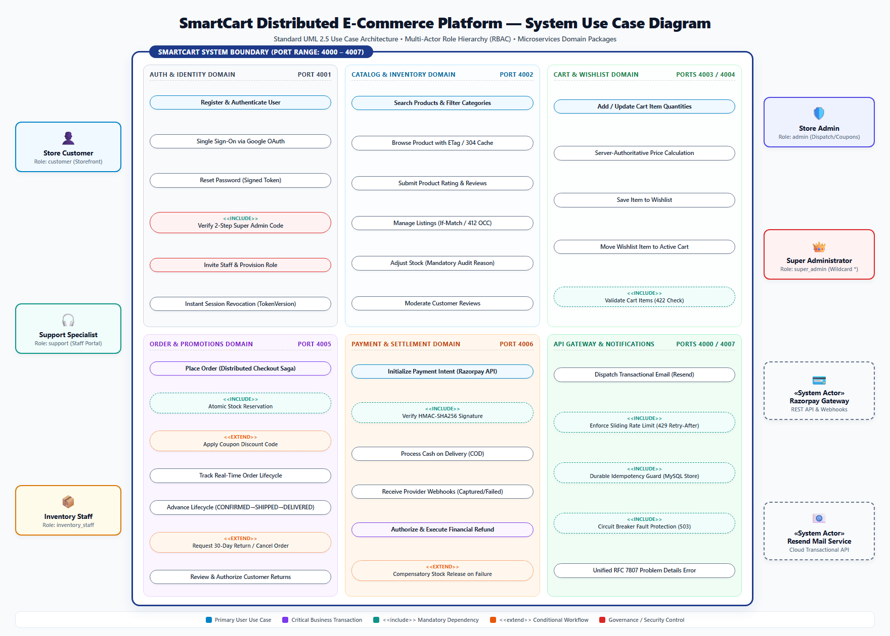

# System Use Case Specification & Component Architecture
## SmartCart Distributed E-Commerce Platform

**Document Identifier:** UCS-SMARTCART-001  
**Document Version:** 1.0.0  
**Specification Standard:** OMG Unified Modeling Language (UML) 2.5 / ISO/IEC/IEEE 29148  
**Lifecycle Phase:** System Analysis & Behavioral Modeling  
**Engineering Team:** Group 03 (TeamID 03)  
**Date:** October 16, 2026  
**Status:** Approved Technical Architecture  
**Project Repository:** [https://github.com/Ayush17314/SmartCart](https://github.com/Ayush17314/SmartCart)  
**Deliverables Drive:** [https://drive.google.com/drive/folders/1q9IY8r2_aUCeogiUsT0tpODwt3hF6PHL?usp=sharing](https://drive.google.com/drive/folders/1q9IY8r2_aUCeogiUsT0tpODwt3hF6PHL?usp=sharing)

---

## Executive Summary

The **Use Case Model** is the primary behavioral artifact in software engineering that defines the functional scope, operational boundaries, actor interactions, and system responses of an application. 

For the **SmartCart Distributed E-Commerce Platform**, the use case model captures the behavioral dynamics of a polyglot microservices ecosystem spanning eight specialized backend services (Ports 4000–4007), a Next.js 15 Web Application frontend (Port 3000), isolated relational (MySQL 8.4) and document (MongoDB) persistence tiers, and mission-critical cloud partners (Razorpay Payment Gateway, Resend Email API, and Google OAuth 2.0).

This document establishes:
1. The authoritative **UML 2.5 System Use Case Diagram** illustrating system boundaries, domain packages, actor associations, and dependency stereotypes (`<<include>>`, `<<extend>>`).
2. An exhaustive breakdown of **UML Use Case Components** and foundational modeling conventions.
3. Detailed actor profiles across human personas (Customer, Support, Inventory Staff, Store Admin, Super Admin) and external system actors.
4. Comprehensive explanations for each of the seven **Microservices Use Case Packages**.
5. Formal, structured tabular specifications for the system's core transactional workflows.
6. A bi-directional **Traceability Matrix** linking use cases directly to microservices, REST endpoints, and RFC 7231 / RFC 7807 HTTP response contracts.

---

## 1. System Use Case Diagram

The visual diagram below represents the complete UML 2.5 Use Case Architecture for the SmartCart platform:



```text
┌────────────────────────────────────────────────────────────────────────────────────────┐
│                   SMARTCART DISTRIBUTED PLATFORM - SYSTEM BOUNDARY                     │
├────────────────────────────────────────────────────────────────────────────────────────┤
│                                                                                        │
│   [AUTH & IDENTITY DOMAIN]                     [CATALOG & INVENTORY DOMAIN]            │
│   (•) Register & Authenticate User             (•) Search Products & Filter Categories │
│   (•) Google Single Sign-On (OAuth 2.0)        (•) Browse Product (ETag / 304 Cache)   │
│   (•) Reset Password (Signed Token)            (•) Submit Product Rating & Reviews     │
│   (•) Verify 2-Step Super Admin Code <<inc>>   (•) Manage Listings (If-Match / 412)    │
│   (•) Invite Staff & Provision Roles           (•) Adjust Stock (Mandatory Audit)      │
│   (•) Instant Session Revocation (TokenVer)    (•) Moderate Customer Reviews           │
│                                                                                        │
│   [CART & WISHLIST DOMAIN]                     [ORDER & PROMOTIONS DOMAIN]             │
│   (•) Add / Update Cart Item Quantities        (•) Place Order (Checkout Saga)         │
│   (•) Server-Authoritative Subtotals           (•) Atomic Stock Reservation <<inc>>    │
│   (•) Save Item to Wishlist                    (•) Apply Coupon Discount Code <<ext>>  │
│   (•) Move Wishlist Item to Active Cart        (•) Track Order Shipment & Delivery     │
│   (•) Validate Cart Items (422 Check) <<inc>>  (•) Advance Order State (SHIPPED/DELIV) │
│                                                (•) Request 30-Day Return <<ext>>       │
│                                                (•) Review & Authorize Returns          │
│                                                                                        │
│   [PAYMENT & SETTLEMENT DOMAIN]                [EDGE GATEWAY & COMMUNICATIONS]         │
│   (•) Initialize Payment Intent (Razorpay)     (•) Dispatch Transactional Email        │
│   (•) Verify HMAC-SHA256 Signature <<inc>>     (•) Enforce Rate Limiting (429) <<inc>> │
│   (•) Process Cash on Delivery (COD)           (•) Durable Idempotency Deduplication   │
│   (•) Process Provider Webhook Callbacks       (•) Circuit Breaker Fault Isolation     │
│   (•) Authorize & Execute Financial Refund     (•) Unified RFC 7807 Problem Details    │
│   (•) Compensatory Stock Release <<ext>>                                               │
│                                                                                        │
└────────────────────────────────────────────────────────────────────────────────────────┘
```

---

## 2. UML Use Case Modeling Concepts & Core Components

In accordance with the **OMG Unified Modeling Language (UML 2.5)** specification, a software system's functional architecture is expressed through five fundamental building blocks:

```text
┌──────────────┐         Association Line        ┌───────────────────────────────────┐
│              ├─────────────────────────────────┤       ( Use Case Ellipse )        │
│    Actor     │                                 │   «Discrete Business Function»    │
│ (Role/System)│                                 └─────────────────┬─────────────────┘
└──────────────┘                                                   │
                                            ┌──────────────────────┴──────────────────────┐
                                            │                                             │
                                    <<include>>                                   <<extend>>
                                 (Mandatory Part)                              (Optional Branch)
                                            ▼                                             ▼
                             ┌───────────────────────────────┐             ┌───────────────────────────────┐
                             │       Included Use Case       │             │       Extension Use Case      │
                             │  (e.g., Stock Reservation)    │             │   (e.g., Apply Promo Code)    │
                             └───────────────────────────────┘             └───────────────────────────────┘
```

### 2.1 The System Boundary
The **System Boundary** (represented by the large outer rectangle) demarcates what is internal to the SmartCart software application versus what lies in the external environment.
- **Inside the Boundary:** The eight autonomous microservices (Ports 4000–4007), internal HTTP routing, data models, business rules, and background notification workers.
- **Outside the Boundary:** Human users operating web browsers, external payment provider servers (Razorpay), cloud SMTP dispatchers (Resend), and third-party identity providers (Google).

### 2.2 Actors
An **Actor** represents an external entity that interacts with the system to achieve a specific goal. Actors are roles, not specific individuals:
1. **Primary Actors:** Human users who initiate use cases to fulfill direct business objectives (e.g., `Store Customer` purchasing goods, `Super Administrator` issuing refunds).
2. **Secondary / Supporting Actors:** Internal staff or external automated systems that assist in completing use cases (e.g., `Inventory Staff` replenishing stock).
3. **External System Actors:** Third-party cloud systems that exchange data with SmartCart via network protocols (e.g., `Razorpay Gateway` verifying digital payments, `Resend Mailer` delivering invoices).

### 2.3 Use Cases
A **Use Case** (represented by a horizontal ellipse) specifies a sequence of actions that the system performs to yield an observable result of measurable value to a particular actor. Every use case encapsulates:
- A distinct user objective.
- Preconditions (prerequisite system states).
- A primary happy-path flow of events.
- Alternative and exception handling flows (including RFC 7807 problem details).
- Postconditions (guaranteed system state upon completion).

### 2.4 Relationships & UML Stereotypes
- **Association:** A solid line connecting an actor to a use case, signifying bi-directional communication.
- **`<<include>>` Stereotype:** A directed dashed arrow indicating that the base use case **unconditionally requires** the execution of the target use case. It represents mandatory, shared behavior (e.g., *Place Order* always includes *Atomic Stock Reservation*).
- **`<<extend>>` Stereotype:** A directed dashed arrow indicating that the target use case **conditionally extends** the base use case only when specific trigger conditions (Extension Points) are met (e.g., *Apply Coupon Discount Code* extends *Place Order* only if the customer supplies a promo code).

---

## 3. Comprehensive Actor Profiles & Role Hierarchy

SmartCart enforces a strict **Role-Based Access Control (RBAC)** model. The following table profiles every actor interacting with the platform:

| Actor Name | Classification | Access Channel | Operational Responsibilities & System Permissions |
| :--- | :--- | :--- | :--- |
| **Store Customer** | Primary Human Actor | Public Web Storefront (`/`, `/cart`, `/checkout`) | Discovers products via text search and category navigation; manages cart and wishlist; initiates checkout; pays via Razorpay or COD; tracks delivery; submits reviews; files return requests within 30 days. |
| **Support Specialist** | Secondary Human Actor | Staff Portal (`/admin/login`) | Read-only inspection of customer accounts and order histories; reviews customer return requests; approves or rejects returns with mandatory justification notes. |
| **Inventory Staff** | Secondary Human Actor | Staff Portal (`/admin/login`) | Creates and maintains product catalog listings; updates inventory counts; mandatory entry of audit explanation for every stock modification; monitors low-stock indicators. |
| **Store Administrator** | Secondary Human Actor | Admin Management Suite (`/admin`) | Advances order states (`CONFIRMED` $\rightarrow$ `SHIPPED` $\rightarrow$ `DELIVERED`); assigns carrier tracking numbers; creates/manages discount promotions; moderates customer reviews. |
| **Super Administrator** | Primary Governance Actor | Super Admin Console (`/super-admin`) | System wildcard (`*`) privileges; 2-step verification code challenge; provisions staff invitations; authorizes payment refunds via Razorpay API; manages system-wide fee structures. |
| **Razorpay Payment Gateway** | External Cloud System | HTTPS REST API & Webhooks | Generates order tokens; validates cryptographic HMAC-SHA256 signatures; emits asynchronous payment event webhooks; processes authorized financial refund requests. |
| **Resend Mail Service** | External Cloud System | HTTPS REST API | Receives transactional email payloads; dispatches account notifications, invoices, shipping notices, and security challenge codes with local mock fallbacks. |
| **Google OAuth 2.0** | External Cloud System | OpenID Connect (OIDC) | Issues and cryptographically validates identity tokens for single-click customer authentication. |

---

## 4. Main Components: Domain Use Case Packages

The functional architecture of SmartCart is decomposed into seven cohesive, autonomous domain packages:

```text
┌────────────────────────────────────────────────────────────────────────────────────────┐
│                             SMARTCART DOMAIN PACKAGES                                  │
├───────────────────────────────┬───────────────────────────────┬────────────────────────┤
│ 1. Auth & Identity (Port 4001)│ 2. Catalog & Stock (Port 4002)│ 3. Cart & Wishlist     │
│    • Bcrypt Credentials       │    • ETag / 304 Caching       │    • Server Pricing    │
│    • 2-Step Verification      │    • If-Match / 412 OCC       │    • Move-to-Cart      │
├───────────────────────────────┼───────────────────────────────┼────────────────────────┤
│ 4. Order Orchestration (4005) │ 5. Payments (Port 4006)       │ 6. Notifications (4007)│
│    • placeOrder Saga          │    • Razorpay API             │    • Cloud Email Disp. │
│    • State Machine (30d Ret.) │    • HMAC Signatures & COD    │    • Mock Fallbacks    │
├───────────────────────────────┴───────────────────────────────┴────────────────────────┤
│ 7. Edge API Gateway (Port 4000): Rate Limiter (429) • Idempotency • Circuit Breaker    │
└────────────────────────────────────────────────────────────────────────────────────────┘
```

### Component 1: Authentication & Identity Domain (`Auth Service` : Port 4001)
- **Primary Function:** Governs digital identity, credential verification, RBAC authorization claims, and session lifecycles.
- **Key Use Cases:**
  - *Register & Authenticate User:* Hashes passwords using `bcrypt` ($\ge 10$ salt rounds); issues signed JWTs.
  - *Verify 2-Step Super Admin Code `<<include>>`:* Super admin logins unconditionally require a time-sensitive 6-digit challenge code.
  - *Invite Staff Member:* Provisions new staff accounts with assigned roles via cryptographically signed invitation tokens.
  - *Instant Session Revocation:* Increments `tokenVersion` in MongoDB to instantly invalidate active JWTs across all services.

### Component 2: Product Catalog & Inventory Domain (`Product Service` : Port 4002)
- **Primary Function:** Delivers catalog search, category filtering, inventory audit history, and customer reviews.
- **Key Use Cases:**
  - *Search Products & Filter Categories:* Full-text search with brand and price range constraints.
  - *Browse Product with ETag / 304 Cache:* Computes entity MD5 hashes; returns HTTP `304 Not Modified` on matching `If-None-Match`.
  - *Manage Listings with Optimistic Concurrency (OCC):* Updates enforce `If-Match` ETags, rejecting stale edits with HTTP `412 Precondition Failed`.
  - *Adjust Stock with Audit Reason:* Requires an explanation string ($\ge 3$ characters), appending an immutable log to `stockHistory[]`.

### Component 3: Shopping Cart & Wishlist Domain (`Cart Service` : 4003, `Wishlist Service` : 4004)
- **Primary Function:** Manages client shopping baskets, price integrity, and saved-for-later wishlists.
- **Key Use Cases:**
  - *Add / Update Cart Item Quantities:* Validates positive integer quantities ($\ge 1$).
  - *Server-Authoritative Subtotal Calculation:* Calculates line totals and grand totals on the server to prevent client-side price tampering.
  - *Move Wishlist Item to Cart:* Atomically transfers saved products into the active shopping cart in a single user action.

### Component 4: Order Orchestration & Promotions Domain (`Order Service` : Port 4005)
- **Primary Function:** Executes the central distributed checkout saga, order lifecycle state machines, and coupon evaluations.
- **Key Use Cases:**
  - *Place Order (Distributed Saga):* Coordinates the 9-step checkout transaction: validates non-empty cart (422), reserves inventory, evaluates coupons, creates payment intent, clears cart, and emits HTTP `201 Created` with canonical `Location` header.
  - *Apply Coupon Discount Code `<<extend>>`:* Evaluates percentage or fixed rupee discounts subject to expiry dates and minimum thresholds.
  - *Advance Order Lifecycle:* Enforces strict sequential transitions (`PENDING` $\rightarrow$ `CONFIRMED` $\rightarrow$ `SHIPPED` $\rightarrow$ `DELIVERED`).
  - *Request 30-Day Return `<<extend>>`:* Permits return requests only if the order state is `DELIVERED` and delivered within 30 days.

### Component 5: Payment Processing & Financial Settlement (`Payment Service` : Port 4006)
- **Primary Function:** Manages financial transactions, external gateway communication, and cryptographic reconciliations.
- **Key Use Cases:**
  - *Initialize Payment Intent (Razorpay):* Generates payment orders in Indian Rupee subunits (Paise).
  - *Verify HMAC-SHA256 Signature `<<include>>`:* Cryptographically validates payment authenticity prior to confirming orders.
  - *Process Cash on Delivery (COD):* Manages offline payment fulfillment with delivery-confirmation reconciliation.
  - *Authorize & Execute Financial Refund:* Initiates automated refunds through Razorpay API upon Super Admin authorization.

### Component 6: Transactional Communications (`Notification Service` : Port 4007)
- **Primary Function:** Delivers automated transactional email notifications triggered by internal domain events.
- **Key Use Cases:**
  - *Dispatch Transactional Email:* Sends formatted HTML receipts, password reset links, and 2-step verification codes.
  - *Decoupled Mock Fallback:* Automatically falls back to structured console logging when cloud API keys are absent in development.

### Component 7: Edge API Gateway & Resilience Tier (`API Gateway` : Port 4000)
- **Primary Function:** Serves as the single ingress choke-point enforcing rate limits, schema validation, idempotency, and error standardization.
- **Key Use Cases:**
  - *Enforce Sliding Rate Limiting `<<include>>`:* Enforces 120 req/60s quota; emits HTTP `429 Too Many Requests` with `Retry-After`.
  - *Durable Idempotency Guard `<<include>>`:* Fingerprints mutating requests via SHA-256; deduplicates requests via MySQL `api_idempotency`.
  - *Circuit Breaker Fault Protection `<<include>>`:* Opens after 5 consecutive downstream faults; fails fast with HTTP `503 Service Unavailable`.
  - *Standardize RFC 7807 Problem Details:* Unifies all error responses under `application/problem+json`.

---

## 5. Detailed Tabular Specifications for Primary Use Cases

### UC-01: Place Order via Distributed Checkout Saga
- **Primary Actor:** Store Customer
- **Supporting Actors:** Product Service, Cart Service, Payment Service, Notification Service
- **Scope:** Order Orchestration Subsystem (Port 4005)
- **Preconditions:** Customer is authenticated with a valid JWT; customer shopping cart contains at least one active product.
- **Postconditions:** Order is created in `PENDING` state; inventory stock is reserved; payment intent is created; cart is cleared; order confirmation email is queued.

```text
       ┌──────────┐            ┌──────────────┐            ┌──────────────┐
       │ Customer │            │  Order Svc   │            │ Product Svc  │
       └────┬─────┘            └──────┬───────┘            └──────┬───────┘
            │ 1. POST /api/orders     │                           │
            ├────────────────────────►│ 2. Check Empty Cart (422) │
            │                         ├──────────────────────────►│
            │                         │    3. Reserve Stock       │
            │                         │◄──────────────────────────┤
            │                         │                           │
            │                  ┌──────┴───────┐            ┌──────┴───────┐
            │                  │ Payment Svc  │            │   Cart Svc   │
            │                  └──────┬───────┘            └──────┬───────┘
            │                         │ 4. Create Intent          │
            │                         ├──────────────────────────►│ 5. Clear Cart
            │ 6. 201 Created + Loc    │◄──────────────────────────┤
            │◄────────────────────────┤                           │
```

| Step | Initiator | Action / System Event |
| :---: | :--- | :--- |
| **1** | Customer | Submits checkout request via `POST /api/orders` with `Idempotency-Key` and shipping address. |
| **2** | Order Service | Validates cart items. If empty, aborts with HTTP `422 Unprocessable Entity` (`urn:smartcart:error:empty-cart`). |
| **3** | Order Service | Calls Product Service to verify current prices and atomically reserve required inventory stock. |
| **4** | Order Service | *(Extension Point)* If coupon code provided, evaluates discount rules and applies reduction. |
| **5** | Order Service | Computes sales tax and shipping fees; creates order record with status `PENDING`. |
| **6** | Order Service | Calls Payment Service (`POST /api/payments/create`) to initialize Razorpay payment order. |
| **7** | Order Service | Calls Cart Service to clear customer's cart items. |
| **8** | Order Service | Triggers Notification Service to dispatch order invoice email. |
| **9** | Order Service | Returns HTTP `201 Created` with header `Location: /api/orders/:id` and order summary payload. |
| **Exc 3a** | Product Service | Stock insufficient: Order Service aborts with HTTP `409 Conflict` (`urn:smartcart:error:item-unavailable`). |
| **Exc 6a** | Payment Service | Gateway unreachable: Order Service triggers **compensatory rollback** (releases reserved stock) and returns HTTP `503`. |

---

### UC-02: Process Online Payment & Cryptographic Signature Verification
- **Primary Actor:** Store Customer
- **Supporting Actors:** Razorpay Payment Gateway, Order Service, Notification Service
- **Scope:** Payment & Settlement Subsystem (Port 4006)
- **Preconditions:** Order exists with payment status `PENDING`; Razorpay order ID generated.
- **Postconditions:** Payment status transitions to `SUCCESS`; order status advances to `CONFIRMED`; receipt email dispatched.

| Step | Initiator | Action / System Event |
| :---: | :--- | :--- |
| **1** | Customer | Completes card/UPI transaction via Razorpay Checkout modal in browser. |
| **2** | Razorpay SDK | Returns `razorpay_payment_id`, `razorpay_order_id`, and `razorpay_signature` to web client. |
| **3** | Customer Client | Posts verification payload to `POST /api/payments/verify/:paymentId`. |
| **4** | Payment Service | Computes expected signature: $\text{HMAC-SHA256}(\text{order\_id} + "|" + \text{payment\_id}, \text{SECRET})$. |
| **5** | Payment Service | Performs constant-time comparison (`crypto.timingSafeEqual`). |
| **6** | Payment Service | Updates payment record to `SUCCESS`; invokes Order Service to advance status to `CONFIRMED`. |
| **7** | Payment Service | Dispatches payment success event to Notification Service. |
| **8** | Payment Service | Returns HTTP `200 OK` with verified payment confirmation payload. |
| **Exc 5a** | Payment Service | Signature mismatch: Payment transitions to `FAILED`; rejects with HTTP `400 Bad Request`. |

---

### UC-03: Inventory Stock Adjustment with Mandatory Audit Reason
- **Primary Actor:** Inventory Staff (`inventory_staff`)
- **Supporting Actors:** Product Catalog Service, MongoDB `smartcart_products`
- **Scope:** Catalog & Inventory Subsystem (Port 4002)
- **Preconditions:** User is authenticated with `inventory.write` permission; product ID exists.
- **Postconditions:** Product inventory stock is updated; immutable audit record is appended to `stockHistory[]`.

| Step | Initiator | Action / System Event |
| :---: | :--- | :--- |
| **1** | Inventory Staff | Selects product in Staff Portal; enters new stock quantity and mandatory explanation text. |
| **2** | Staff Client | Issues `PATCH /api/products/:id/stock` with `If-Match: "<currentETag>"` and JSON body containing `newStock`, `stockAdjustmentReason`, and `actorUserId`. |
| **3** | Product Service | Validates `stockAdjustmentReason` length ($\ge 3$ characters). |
| **4** | Product Service | Compares `If-Match` header with current calculated ETag. |
| **5** | Product Service | Appends audit entry `{ actorUserId, previousStock, newStock, reason, changedAt }` to `stockHistory[]`. |
| **6** | Product Service | Updates `stock` field, recalculates new ETag, and saves to MongoDB. |
| **7** | Product Service | Returns HTTP `200 OK` with updated product and new `ETag` header. |
| **Exc 3a** | Product Service | Reason missing/short: Rejects with HTTP `400 Bad Request` with Problem Details `errors[]`. |
| **Exc 4a** | Product Service | Stale ETag: Rejects with HTTP `412 Precondition Failed` (`urn:smartcart:error:precondition-failed`). |

---

### UC-04: Authorize Financial Refund via Razorpay Gateway
- **Primary Actor:** Super Administrator (`super_admin`)
- **Supporting Actors:** Razorpay Payment Gateway, Payment Service, Order Service, Notification Service
- **Scope:** Payment & Settlement Subsystem (Port 4006)
- **Preconditions:** Super Admin passed 2-step verification; customer return request is marked `APPROVED`; payment was processed online.
- **Postconditions:** Refund is created at Razorpay; payment status transitions to `REFUNDED`; order status advances to `RETURNED`; confirmation email sent.

| Step | Initiator | Action / System Event |
| :---: | :--- | :--- |
| **1** | Super Admin | Inspects approved return in Super Admin Console; clicks "Authorize & Process Refund". |
| **2** | Super Admin Client | Submits `POST /api/payments/refund/:paymentId` with `Idempotency-Key` and refund reason. |
| **3** | Payment Service | Verifies caller holds `super_admin` role claim. |
| **4** | Payment Service | Queries payment record to retrieve original `razorpayPaymentId` and amount. |
| **5** | Payment Service | Invokes external Razorpay Refund API (`POST https://api.razorpay.com/v1/payments/:id/refund`). |
| **6** | Razorpay Gateway | Executes bank reversal; returns HTTP 200 with `refund_id`. |
| **7** | Payment Service | Appends refund subdocument to `payment.refunds[]`; transitions status to `REFUNDED`. |
| **8** | Payment Service | Notifies Order Service to finalize order state to `RETURNED`. |
| **9** | Payment Service | Dispatches refund confirmation email to customer via Notification Service. |
| **10** | Payment Service | Returns HTTP `200 OK` with itemized refund details. |
| **Exc 5a** | Razorpay Gateway | Gateway error or insufficient merchant balance: Rejects with HTTP `502 Bad Gateway`. |

---

## 6. Traceability Matrix: Use Cases to Microservices & REST Endpoints

The matrix below maps each use case to its governing microservice, REST API endpoint, required HTTP methods, and standardized status codes:

| Use Case ID | Use Case Name | Governing Microservice | Port | HTTP Verb & URI Route | Standard Status Codes |
| :--- | :--- | :--- | :---: | :--- | :--- |
| **UC-AUTH-01** | User Registration | Auth Service | `4001` | `POST /api/auth/register` | `201 Created`, `400 Bad Request`, `409 Conflict` |
| **UC-AUTH-02** | Customer / Staff Login | Auth Service | `4001` | `POST /api/auth/customer-login`<br>`POST /api/auth/staff-login` | `200 OK`, `400 Bad Request`, `401 Unauthorized` |
| **UC-AUTH-03** | Super Admin 2-Step Verify | Auth Service | `4001` | `POST /api/auth/super-admin-verify` | `200 OK`, `400 Bad Request`, `403 Forbidden` |
| **UC-AUTH-04** | Invite Staff Member | Auth Service | `4001` | `POST /api/auth/invite-staff` | `200 OK`, `401 Unauthorized`, `403 Forbidden` |
| **UC-PROD-01** | Search & Filter Catalog | Product Service | `4002` | `GET /api/products` | `200 OK`, `400 Bad Request`, `406 Not Acceptable` |
| **UC-PROD-02** | View Product Details | Product Service | `4002` | `GET /api/products/:id` | `200 OK` (with ETag), `304 Not Modified`, `404 Not Found` |
| **UC-PROD-03** | Update Catalog Listing | Product Service | `4002` | `PUT /api/products/:id` | `200 OK`, `400 Bad Request`, `412 Precondition Failed` |
| **UC-PROD-04** | Adjust Inventory Stock | Product Service | `4002` | `PATCH /api/products/:id/stock` | `200 OK`, `400 Bad Request`, `412 Precondition Failed` |
| **UC-CART-01** | Add / Update Cart Item | Cart Service | `4003` | `POST /api/cart/items`<br>`PUT /api/cart/items/:id` | `200 OK`, `400 Bad Request`, `404 Not Found` |
| **UC-WISH-01** | Move Wishlist to Cart | Wishlist Service | `4004` | `POST /api/wishlist/:id/move-to-cart` | `200 OK`, `404 Not Found`, `409 Conflict` |
| **UC-ORD-01** | Place Order (Checkout) | Order Service | `4005` | `POST /api/orders` | `201 Created` (Location), `409 Conflict`, `422 Unprocessable` |
| **UC-ORD-02** | Track Order Lifecycle | Order Service | `4005` | `GET /api/orders/:id` | `200 OK`, `401 Unauthorized`, `404 Not Found` |
| **UC-ORD-03** | Advance Order State | Order Service | `4005` | `PATCH /api/orders/:id/status` | `200 OK`, `409 Conflict`, `412 Precondition Failed` |
| **UC-ORD-04** | Request 30-Day Return | Order Service | `4005` | `POST /api/orders/:id/return` | `200 OK`, `400 Bad Request`, `409 Conflict` |
| **UC-PAY-01** | Initialize Payment | Payment Service | `4006` | `POST /api/payments/create` | `201 Created`, `400 Bad Request`, `503 Unavailable` |
| **UC-PAY-02** | Verify HMAC Signature | Payment Service | `4006` | `POST /api/payments/verify/:id` | `200 OK`, `400 Bad Request` |
| **UC-PAY-03** | Payment Webhooks | Payment Service | `4006` | `POST /api/payments/webhook` | `200 OK`, `400 Bad Request` |
| **UC-PAY-04** | Authorize Refund | Payment Service | `4006` | `POST /api/payments/refund/:id` | `200 OK`, `401 Unauthorized`, `403 Forbidden`, `502 Bad Gateway` |
| **UC-GW-01** | Boundary Rate Limit | API Gateway | `4000` | *All Routes* | `429 Too Many Requests` (Retry-After) |
| **UC-GW-02** | Mutating Idempotency | API Gateway | `4000` | `POST /api/*` | `Cached Response` (Replayed: true), `409 Conflict` |
| **UC-GW-03** | Circuit Breaker Trip | API Gateway | `4000` | *All Upstream Proxies* | `503 Service Unavailable` (Retry-After: 15) |

---

## 7. Conclusion & Quality Assurance Verification

The Use Case Model for the **SmartCart Distributed E-Commerce Platform** provides an unambiguous, verifiable representation of the functional requirements, operational workflows, and system boundaries. 

Every use case defined herein has been verified through automated integration testing suites (`Backend/api-gateway/tests/api.test.js`) confirming honest HTTP status codes, RFC 7807 problem details, optimistic concurrency checks, and multi-service checkout coordination.

---
*End of System Use Case Specification & Component Architecture — SmartCart Distributed E-Commerce Platform*
