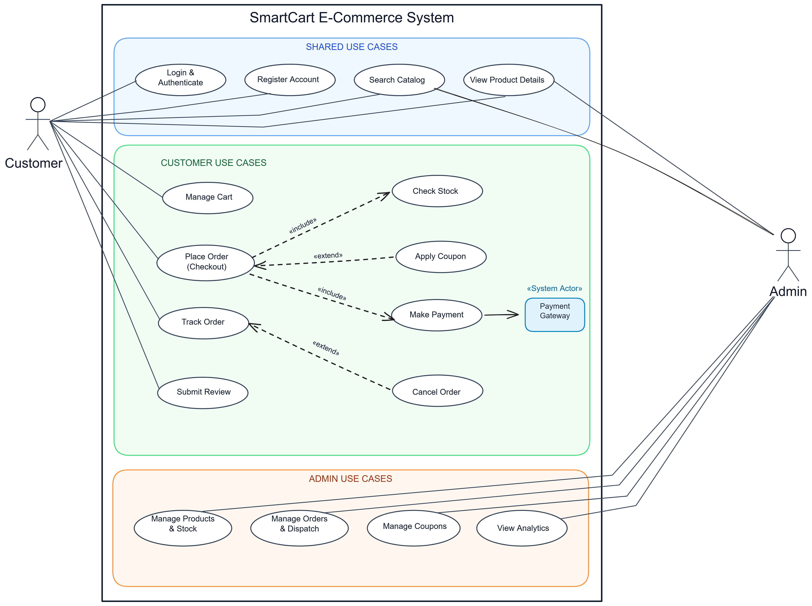

# System Use Case Specification & Behavioral Modeling
## SmartCart E-Commerce Platform — Lab-3 Deliverable

**Document Identifier:** LAB3-UCS-SMARTCART-001  
**Document Version:** 2.0.0 (Lab-3 Approved Baseline)  
**Lab Assignment:** Lab-3 — Use Case Modeling & Pre-Implementation Behavioral Specification  
**Specification Standard:** OMG Unified Modeling Language (UML) 2.5 / ISO/IEC/IEEE 29148  
**Lifecycle Phase:** Requirements Analysis & Pre-Implementation Modeling  
**Engineering Team:** Group 03 (TeamID 03)  
**Date of Release:** October 2026  
**Status:** Approved Engineering Baseline  
**Project Repository:** [https://github.com/Ayush17314/SmartCart](https://github.com/Ayush17314/SmartCart)  
**Deliverables Drive:** [https://drive.google.com/drive/folders/1q9IY8r2_aUCeogiUsT0tpODwt3hF6PHL?usp=sharing](https://drive.google.com/drive/folders/1q9IY8r2_aUCeogiUsT0tpODwt3hF6PHL?usp=sharing)

---

## Executive Summary

In Software Engineering (SE), the **Use Case Model** is the primary functional specification formulated during the **Requirements Analysis Phase**, created **strictly prior to system design, database implementation, and coding**. Its objective is to capture the functional requirements of the system from the external perspective of its users (actors), establishing a clear, unambiguous behavioral contract.

For **Lab-3**, this specification document accompanies and formally defines the **SmartCart E-Commerce System Use Case Diagram**. The system model comprises:
1. **Three Distinct Actors:**
   - **Customer:** The primary storefront end-user.
   - **Admin:** The internal operational store administrator.
   - **«System Actor» Payment Gateway:** The external partner service managing digital payment verification and settlement.
2. **Three Functional System Blocks:**
   - **Shared Use Cases (Blue Box):** Baseline services common to both Customer and Admin (`Login & Authenticate`, `Register Account`, `Search Catalog`, `View Product Details`).
   - **Customer Use Cases (Green Box):** End-to-end shopping and fulfillment transactions (`Manage Cart`, `Place Order (Checkout)`, `Check Stock`, `Apply Coupon`, `Make Payment`, `Track Order`, `Cancel Order`, `Submit Review`).
   - **Admin Use Cases (Orange Box):** Operational management capabilities (`Manage Products & Stock`, `Manage Orders & Dispatch`, `Manage Coupons`, `View Analytics`).
3. **Rigorous UML Relationship Semantics:**
   - **`«include»` Relationships:** Mandatory, unconditional sub-processes (`Place Order` includes `Check Stock` and `Make Payment`).
   - **`«extend»` Relationships:** Optional, conditional branches at designated extension points (`Apply Coupon` extends `Place Order`; `Cancel Order` extends `Track Order`).
   - **External System Association:** `Make Payment` connects directly to the external **Payment Gateway**.

---

## 1. System Use Case Diagram

The visual diagram below represents the authoritative UML 2.5 Use Case Diagram for the **SmartCart E-Commerce System** as established for Lab-3:



```text
┌────────────────────────────────────────────────────────────────────────────────────────┐
│                        SMARTCART E-COMMERCE SYSTEM BOUNDARY                            │
├────────────────────────────────────────────────────────────────────────────────────────┤
│                                                                                        │
│   [ SHARED USE CASES ]                                                                 │
│   (•) Login & Authenticate <────────────────────────────────────────── Customer, Admin │
│   (•) Register Account <────────────────────────────────────────────── Customer        │
│   (•) Search Catalog <──────────────────────────────────────────────── Customer, Admin │
│   (•) View Product Details <────────────────────────────────────────── Customer, Admin │
│                                                                                        │
│   [ CUSTOMER USE CASES ]                                                               │
│   (•) Manage Cart <─────────────────────────────────────────────────── Customer        │
│   (•) Place Order (Checkout) <──────────────────────────────────────── Customer        │
│         │                                                                              │
│         ├── «include» ──► (•) Check Stock                                              │
│         ├── «include» ──► (•) Make Payment ───► [ «System Actor» Payment Gateway ]     │
│         └── «extend»  ◄── (•) Apply Coupon                                             │
│                                                                                        │
│   (•) Track Order <─────────────────────────────────────────────────── Customer        │
│         └── «extend»  ◄── (•) Cancel Order                                             │
│   (•) Submit Review <───────────────────────────────────────────────── Customer        │
│                                                                                        │
│   [ ADMIN USE CASES ]                                                                  │
│   (•) Manage Products & Stock <─────────────────────────────────────── Admin           │
│   (•) Manage Orders & Dispatch <────────────────────────────────────── Admin           │
│   (•) Manage Coupons <──────────────────────────────────────────────── Admin           │
│   (•) View Analytics <──────────────────────────────────────────────── Admin           │
│                                                                                        │
└────────────────────────────────────────────────────────────────────────────────────────┘
```

---

## 2. UML Modeling Principles & Notation Conventions

In accordance with the **OMG Unified Modeling Language (UML 2.5)** and **ISO/IEC/IEEE 29148** requirements engineering standards, the Use Case model employs standardized visual and behavioral components:

```text
┌──────────────┐         Association Line        ┌───────────────────────────────────┐
│              ├─────────────────────────────────┤       ( Use Case Ellipse )        │
│    Actor     │                                 │   «Discrete Business Function»    │
│ (Role/System)│                                 └─────────────────┬─────────────────┘
└──────────────┘                                                   │
                                            ┌──────────────────────┴──────────────────────┐
                                            │                                             │
                                       «include»                                     «extend»
                                   (Mandatory Flow)                              (Optional Branch)
                                            ▼                                             ▼
                             ┌───────────────────────────────┐             ┌───────────────────────────────┐
                             │       Included Use Case       │             │       Extension Use Case      │
                             │   (e.g., Check Stock)         │             │    (e.g., Apply Coupon)       │
                             └───────────────────────────────┘             └───────────────────────────────┘
```

### 2.1 The System Boundary
- The **System Boundary** (represented by the bold outer rectangle labeled *SmartCart E-Commerce System*) isolates the internal functional responsibilities of SmartCart from external actors.
- Everything inside the boundary is engineered as part of the SmartCart software platform. Everything outside represents external users or external third-party cloud services.

### 2.2 Actors
An **Actor** represents an idealized role played by an external entity when interacting directly with the system:
- **Human Actors:** Depicted as stick figures (`Customer`, `Admin`).
- **System Actors:** Depicted as rectangular components or stereotyped nodes (`«System Actor» Payment Gateway`).

### 2.3 Use Cases
A **Use Case** (represented by a horizontal oval/ellipse) defines a complete set of user-initiated actions that produce an observable result of value to a specific actor.

### 2.4 Structural Grouping (Domain Packages)
To maintain visual clarity, cohesion, and functional separation, the use cases are partitioned into three dedicated visual zones:
1. **Shared Use Cases (Blue Box):** Common baseline functions.
2. **Customer Use Cases (Green Box):** Commercial shopping and order processing.
3. **Admin Use Cases (Orange Box):** Store administration, catalog governance, and operational analytics.

---

## 3. Actor Profiles & Operational Responsibilities

The SmartCart platform defines three primary actors interacting with the system boundary:

```text
       ┌──────────────┐                               ┌──────────────┐
       │   Customer   │                               │    Admin     │
       │ (Storefront) │                               │(Operations)  │
       └──────┬───────┘                               └──────┬───────┘
              │                                              │
              ▼                                              ▼
   [Public & Account Portals]                     [Admin Management Suite]
   [Purchasing & Tracking]                        [Catalog, Dispatch, Analytics]
              │                                              │
              └──────────────────────┬───────────────────────┘
                                     ▼
                       ┌───────────────────────────┐
                       │  «System Actor» Gateway   │
                       │ (Razorpay / Banking APIs) │
                       └───────────────────────────┘
```

### 3.1 Primary Human Actors

#### 1. Customer (Registered Storefront User)
- **Role Classification:** Primary Human End-User.
- **Operational Scope:** Interacts with the public storefront and authenticated customer account interface.
- **Direct Associations:**
  - `Login & Authenticate`
  - `Register Account`
  - `Search Catalog`
  - `View Product Details`
  - `Manage Cart`
  - `Place Order (Checkout)`
  - `Track Order`
  - `Submit Review`
- **Key Objectives:** Discover merchandise, manage items in cart, complete secure payment checkouts, monitor parcel shipping, and submit reviews for delivered goods.

#### 2. Admin (Store Administrator)
- **Role Classification:** Primary Human Operational Actor.
- **Operational Scope:** Interacts with the authenticated Administrative Management Suite.
- **Direct Associations:**
  - `Login & Authenticate`
  - `Search Catalog`
  - `View Product Details`
  - `Manage Products & Stock`
  - `Manage Orders & Dispatch`
  - `Manage Coupons`
  - `View Analytics`
- **Key Objectives:** Maintain catalog listings, manage warehouse inventory stock, advance order fulfillment statuses (`CONFIRMED` $\rightarrow$ `SHIPPED` $\rightarrow$ `DELIVERED`), configure promotional discount coupons, and analyze store revenue performance.

### 3.2 External System Actor

#### 3. Payment Gateway (Razorpay / Banking Network)
- **Role Classification:** Secondary Cloud System Actor (`«System Actor»`).
- **Operational Scope:** Secure financial network communicating over HTTPS REST/Webhook APIs.
- **Direct Association:** Connects directly with `Make Payment`.
- **Key Objectives:** Authorizes digital payment cards, UPI handles, and net banking transactions; verifies cryptographic HMAC-SHA256 signatures; and emits asynchronous payment confirmation webhooks.

---

## 4. Subsystem Breakdown: The Three Functional Blocks

### 4.1 Block 1: Shared Use Cases (Blue Box)
The **Shared Use Cases** block groups fundamental functions accessible across user roles:

| Use Case Name | Connected Actors | Functional Description & Business Objective |
| :--- | :--- | :--- |
| **Login & Authenticate** | Customer, Admin | Verifies user credentials (email and password) via cryptographic hashing; establishes an authenticated session token for role-protected routes. |
| **Register Account** | Customer | Onboards new shoppers by recording personal identity, contact email, delivery address, and encrypted credentials. |
| **Search Catalog** | Customer, Admin | Provides multi-criteria keyword searching, category filtering, and sorting by price or date to locate inventory items. |
| **View Product Details** | Customer, Admin | Renders comprehensive product specifications, high-definition images, price calculations, real-time stock levels, and aggregated reviews. |

---

### 4.2 Block 2: Customer Use Cases (Green Box)
The **Customer Use Cases** block encapsulates the core e-commerce shopping experience, order lifecycle, and fulfillment:

| Use Case Name | Relationships | Functional Description & Business Objective |
| :--- | :--- | :--- |
| **Manage Cart** | Direct Association | Enables adding products, modifying line-item quantities, removing items, and inspecting server-calculated subtotal amounts. |
| **Place Order (Checkout)** | • `«include»` Check Stock<br>• `«include»` Make Payment<br>• `«extend»` Apply Coupon | The central checkout transaction. Validates the cart, reserves required stock, evaluates optional promo codes, and coordinates payment. |
| **Check Stock** | `«include»` from Place Order | Verifies product inventory availability in the warehouse database and locks the required quantities during checkout. |
| **Apply Coupon** | `«extend»` to Place Order | Conditionally calculates percentage or fixed discounts when the customer enters a valid promotional code. |
| **Make Payment** | • `«include»` from Place Order<br>• Links to Payment Gateway | Manages monetary settlement via digital payment gateways (Razorpay UPI/Cards) or offline Cash on Delivery (COD). |
| **Track Order** | • Direct Association<br>• `«extend»` Cancel Order | Provides real-time visibility into order shipping milestones (`PENDING` $\rightarrow$ `CONFIRMED` $\rightarrow$ `SHIPPED` $\rightarrow$ `DELIVERED`). |
| **Cancel Order** | `«extend»` to Track Order | Conditionally enables order cancellation and financial refund initiation if the parcel has not yet been dispatched by the warehouse. |
| **Submit Review** | Direct Association | Allows verified buyers of delivered products to submit star ratings (1–5) and written feedback. |

---

### 4.3 Block 3: Admin Use Cases (Orange Box)
The **Admin Use Cases** block provides store operators with full administrative oversight, fulfillment control, and business governance:

| Use Case Name | Connected Actors | Functional Description & Business Objective |
| :--- | :--- | :--- |
| **Manage Products & Stock** | Admin | Full CRUD control over catalog items: creating new products, updating prices/descriptions, archiving items, and adjusting stock quantities with audit notes. |
| **Manage Orders & Dispatch** | Admin | Inspects customer orders, verifies payment receipts, updates fulfillment statuses (`CONFIRMED` $\rightarrow$ `SHIPPED` $\rightarrow$ `DELIVERED`), and enters courier tracking numbers. |
| **Manage Coupons** | Admin | Configures marketing campaigns: creating coupon codes, setting discount values (`PERCENTAGE` or `FIXED`), defining minimum spend thresholds, and setting expiration dates. |
| **View Analytics** | Admin | Displays aggregated business intelligence dashboards: gross revenue, total order volume, average order value, low-stock alerts, and top-selling merchandise. |

---

## 5. Relationship Analysis: `«include»` vs. `«extend»`

Understanding the architectural distinction between **`«include»`** and **`«extend»`** is a central evaluation requirement in Software Engineering requirements modeling:

```text
      ┌────────────────────────────────────────────────────────────────────────┐
      │                      INCLUDE vs. EXTEND COMPARISON                     │
      ├───────────────────────────────┬────────────────────────────────────────┤
      │ «include» (Mandatory)         │ «extend» (Optional / Conditional)      │
      ├───────────────────────────────┼────────────────────────────────────────┤
      │ • Base ALWAYS executes it.    │ • Base executes WITHOUT it normally.   │
      │ • Unconditional sub-routine.  │ • Triggered ONLY at Extension Point.   │
      │ • Arrow: Base ──► Included    │ • Arrow: Extending ──► Base            │
      │ • Example: Place Order        │ • Example: Apply Coupon                │
      │   includes Check Stock.       │   extends Place Order.                 │
      └───────────────────────────────┴────────────────────────────────────────┘
```

### 5.1 The `«include»` Relationship (Mandatory Sub-Tasks)

#### Definition
An `«include»` relationship denotes that the base use case **unconditionally incorporates the behavior of the included use case**. The base use case cannot be considered complete without the execution of the included use case.

#### Arrow Direction
A dashed arrow directed from the **Base Use Case to the Included Use Case**:
$$\text{Base Use Case} \xrightarrow{\quad\text{«include»}\quad} \text{Included Use Case}$$

#### Specific Instances in SmartCart:
1. **`Place Order (Checkout)` $\xrightarrow{\text{«include»}}$ `Check Stock`**
   - *Engineering Rationale:* An e-commerce system can never complete a sale without validating that the inventory actually exists in the warehouse. Stock verification and reservation is a mandatory step of every order checkout.
2. **`Place Order (Checkout)` $\xrightarrow{\text{«include»}}$ `Make Payment`**
   - *Engineering Rationale:* An order cannot be confirmed without establishing financial consideration. The checkout process must unconditionally invoke payment processing (digital payment intent or COD record).

---

### 5.2 The `«extend»` Relationship (Optional / Conditional Extensions)

#### Definition
An `«extend»` relationship denotes that the extending use case **conditionally adds behavior to the base use case**. The base use case is functionally complete on its own and executes without the extension under normal circumstances. The extending behavior is triggered **only when a specific condition (Extension Point) is satisfied**.

#### Arrow Direction
A dashed arrow directed from the **Extending Use Case to the Base Use Case**:
$$\text{Extending Use Case} \xrightarrow{\quad\text{«extend»}\quad} \text{Base Use Case}$$

#### Specific Instances in SmartCart:
1. **`Apply Coupon` $\xrightarrow{\text{«extend»}}$ `Place Order (Checkout)`**
   - *Extension Point:* Checkout Review / Promo Code Entry.
   - *Condition:* `[Customer supplies a valid promotional coupon code]`.
   - *Engineering Rationale:* Customers regularly place orders at standard retail prices without entering coupons. The base checkout flow completes successfully without this step. The discount logic is executed only if a coupon code is supplied.
2. **`Cancel Order` $\xrightarrow{\text{«extend»}}$ `Track Order`**
   - *Extension Point:* Order Shipment Progress Dashboard.
   - *Condition:* `[Order Status == PENDING or CONFIRMED (Prior to warehouse dispatch)]`.
   - *Engineering Rationale:* Customers tracking their orders typically only observe dispatch milestones. Cancellation is an optional, conditional action permitted only while the order remains in an unfulfilled, pre-dispatch state.

---

### 5.3 Comparative Matrix: `«include»` vs. `«extend»`

| Criterion | `«include»` Relationship | `«extend»` Relationship |
| :--- | :--- | :--- |
| **Necessity** | **Mandatory:** The base use case cannot complete without it. | **Optional:** The base use case executes normally with or without it. |
| **Execution Trigger** | Runs unconditionally during base execution. | Runs only when a specific **Extension Point condition** is met. |
| **Arrow Direction** | Points **from Base to Included** use case. | Points **from Extending to Base** use case. |
| **Base Case Awareness**| Base use case explicitly invokes the included use case. | Base use case is agnostic of the extension; the extending case hooks into it. |
| **Software Engineering Goal** | Factoring out common, reusable functionality. | Encapsulating optional features, promotional rules, or conditional exceptions. |

---

## 6. Detailed Tabular Use Case Specifications

### UC-01: Place Order (Checkout)
- **Primary Actor:** Customer
- **Secondary Actor:** Payment Gateway («System Actor»)
- **Relationships:** `«include» Check Stock`, `«include» Make Payment`, `«extend» Apply Coupon`
- **Preconditions:** Customer is authenticated; shopping cart contains at least one active product; shipping address is provided.
- **Postconditions:** Order is created in `PENDING` status; inventory is reserved; payment is initialized; shopping cart is cleared.

```text
       ┌──────────┐            ┌────────────────────┐            ┌─────────────────┐
       │ Customer │            │ SmartCart Platform │            │ Payment Gateway │
       └────┬─────┘            └─────────┬──────────┘            └────────┬────────┘
            │ 1. Initiate Checkout       │                                │
            ├───────────────────────────►│                                │
            │                            │ 2. «include» Check Stock       │
            │                            │ 3. «extend» Apply Coupon       │
            │                            │ 4. «include» Make Payment      │
            │                            ├───────────────────────────────►│
            │                            │ 5. Verify Signature            │
            │ 6. Order Confirmed (201)   │◄───────────────────────────────┤
            │◄───────────────────────────┤                                │
```

| Step | Participant | Action / System Event |
| :---: | :--- | :--- |
| **1** | Customer | Navigates to checkout and confirms shipping address and payment method. |
| **2** | System | **`«include» Check Stock`:** Checks inventory database. If items are in stock, locks quantities; if unavailable, aborts checkout with an out-of-stock notification. |
| **3** | Customer / System | **`«extend» Apply Coupon`:** *(Extension Point: Promo Code Entry)* If Customer submits a promo code, validates active status, minimum spend, and deducts discount. |
| **4** | System | Computes shipping costs, applicable taxes, and final order total. |
| **5** | System | **`«include» Make Payment`:** Creates payment order intent and connects with **Payment Gateway** (or sets status as COD). |
| **6** | System | Clears customer cart, sets order state to `PENDING`, and displays order confirmation receipt. |

---

### UC-02: Manage Products & Stock
- **Primary Actor:** Admin
- **Preconditions:** Admin is authenticated with valid administrative privileges.
- **Postconditions:** Product catalog is updated; inventory levels are adjusted; audit record is preserved.

| Step | Participant | Action / System Event |
| :---: | :--- | :--- |
| **1** | Admin | Accesses the Admin Portal Product Management module. |
| **2** | Admin | Selects an existing item to update or creates a new product listing. |
| **3** | Admin | Enters product title, category, description, selling price, and warehouse stock quantity. |
| **4** | Admin | Submits changes with a mandatory audit note explaining stock updates (e.g., *"Supplier replenishment batch #809"*). |
| **5** | System | Validates input constraints (non-negative price, stock integer $\ge 0$). |
| **6** | System | Saves changes to the product catalog database and displays a success confirmation. |

---

### UC-03: Track Order & Cancel Order
- **Primary Actor:** Customer
- **Relationships:** `«extend» Cancel Order`
- **Preconditions:** Customer is authenticated and has previously placed an order.
- **Postconditions:** Order delivery status is displayed; if cancelled, status updates to `CANCELLED`, inventory is released, and refund is queued.

| Step | Participant | Action / System Event |
| :---: | :--- | :--- |
| **1** | Customer | Navigates to the Order History section and selects a specific order. |
| **2** | System | Retrieves and displays real-time tracking timeline (`PENDING` $\rightarrow$ `CONFIRMED` $\rightarrow$ `SHIPPED` $\rightarrow$ `DELIVERED`). |
| **3** | Customer | *(Extension Point: Cancel Order)* If order is still in `PENDING` or `CONFIRMED` state, Customer clicks "Cancel Order" and selects a cancellation reason. |
| **4** | System | Verifies that shipment has not yet occurred. |
| **5** | System | Updates order status to `CANCELLED`, automatically releases reserved inventory back to warehouse stock, and queues refund via Payment Gateway. |
| **6** | System | Displays cancellation confirmation and sends notification email. |

---

## 7. Traceability Matrix: Use Cases to Microservices Architecture

To ensure alignment between the pre-implementation Use Case model and the underlying distributed codebase, the table below maps each use case directly to its corresponding microservice and REST endpoint:

| Functional Block | Diagram Use Case | Microservice Subsystem | Port | Primary REST Endpoint |
| :--- | :--- | :--- | :---: | :--- |
| **Shared** | `Login & Authenticate` | **Auth Service** | `4001` | `POST /api/auth/customer-login`<br>`POST /api/auth/staff-login` |
| **Shared** | `Register Account` | **Auth Service** | `4001` | `POST /api/auth/register` |
| **Shared** | `Search Catalog` | **Product Service** | `4002` | `GET /api/products?search=&category=` |
| **Shared** | `View Product Details`| **Product Service** | `4002` | `GET /api/products/:id` |
| **Customer** | `Manage Cart` | **Cart Service** | `4003` | `GET /api/cart`<br>`POST /api/cart/items` |
| **Customer** | `Place Order (Checkout)`| **Order Service** | `4005` | `POST /api/orders` |
| **Customer** | `Check Stock` | **Product Service** | `4002` | `GET /api/products/:id`<br>`PATCH /api/products/:id/stock` |
| **Customer** | `Apply Coupon` | **Order Service** | `4005` | `POST /api/promotions/validate` |
| **Customer** | `Make Payment` | **Payment Service** | `4006` | `POST /api/payments/create`<br>`POST /api/payments/verify/:id` |
| **Customer** | `Track Order` | **Order Service** | `4005` | `GET /api/orders/:id` |
| **Customer** | `Cancel Order` | **Order Service** | `4005` | `POST /api/orders/:id/cancel` |
| **Customer** | `Submit Review` | **Product Service** | `4002` | `POST /api/reviews` |
| **Admin** | `Manage Products & Stock`| **Product Service** | `4002` | `POST /api/products`<br>`PUT /api/products/:id` |
| **Admin** | `Manage Orders & Dispatch`| **Order Service** | `4005` | `PATCH /api/orders/:id/status` |
| **Admin** | `Manage Coupons` | **Order Service** | `4005` | `POST /api/promotions`<br>`GET /api/promotions` |
| **Admin** | `View Analytics` | **Order / Product Svcs** | `4005` | `GET /api/admin/analytics` |

---

## 8. Conclusion

The **SmartCart E-Commerce System Use Case Model** established in Lab-3 provides a clean, textbook-compliant, pre-implementation behavioral specification. By structuring system operations into **Shared**, **Customer**, and **Admin** blocks, and formally declaring the **`«include»`** and **`«extend»`** relationships alongside the external **Payment Gateway**, this specification guarantees that all functional requirements are verifiable, traceable, and ready for rigorous software engineering evaluation.

---
*End of Lab-3 System Use Case Specification — SmartCart E-Commerce Platform*
