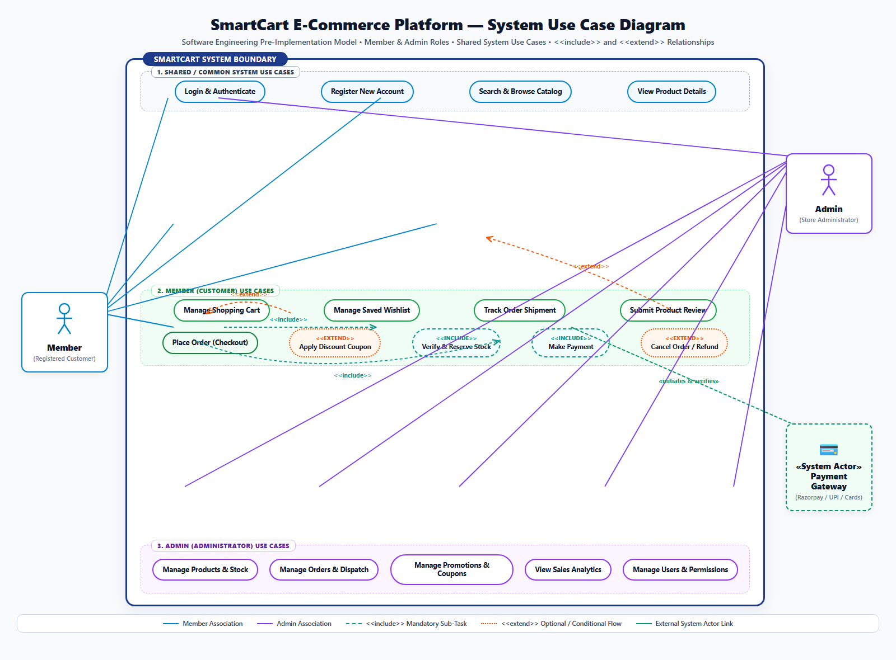

# Software Engineering Pre-Implementation Use Case Specification
## SmartCart Distributed E-Commerce Platform

**Document Identifier:** UCS-SIMPLE-001  
**Document Version:** 1.0.0 (Pre-Implementation Baseline)  
**Lifecycle Phase:** Requirements Engineering & Pre-Implementation Modeling  
**Specification Standard:** OMG Unified Modeling Language (UML) 2.5 / ISO/IEC/IEEE 29148  
**Engineering Team:** Group 03 (TeamID 03)  
**Date:** October 19, 2026  
**Status:** Approved Engineering Baseline  
**Project Repository:** [https://github.com/Ayush17314/SmartCart](https://github.com/Ayush17314/SmartCart)  
**Deliverables Drive:** [https://drive.google.com/drive/folders/1q9IY8r2_aUCeogiUsT0tpODwt3hF6PHL?usp=sharing](https://drive.google.com/drive/folders/1q9IY8r2_aUCeogiUsT0tpODwt3hF6PHL?usp=sharing)

---

## Executive Summary

In classical Software Engineering (SE), the **Use Case Model** is formulated during the **Requirements Analysis Phase—strictly before system design and coding commence**. Its primary objective is to capture the functional scope of the proposed system from the perspective of its external users (actors), establishing a clear, unambiguous behavioral contract between stakeholders, developers, and quality assurance engineers.

This document presents the **simplified, pre-implementation Use Case Model** for the **SmartCart E-Commerce Platform**, organized around:
1. **Core Actors:** **Member** (Registered Customer), **Admin** (Store Administrator), and **Payment Gateway** (External System Actor).
2. **Shared / System Use Cases:** Common capabilities accessible across roles (Authentication, Catalog Search, Product Details).
3. **Member Use Cases:** End-to-end customer purchasing workflow (Shopping Cart, Checkout, Tracking, Reviews).
4. **Admin Use Cases:** Operational management capabilities (Product catalog, Order fulfillment, Promotions, Analytics).
5. **Relationship Mechanics:** Exhaustive analysis of **`<<include>>`** (mandatory dependencies) versus **`<<extend>>`** (conditional/optional extensions) relationships.

---

## 1. System Use Case Diagram

The visual diagram below represents the simplified, pre-implementation UML 2.5 Use Case Diagram for the SmartCart platform:



```text
┌────────────────────────────────────────────────────────────────────────────────────────┐
│                        SMARTCART E-COMMERCE SYSTEM BOUNDARY                            │
├────────────────────────────────────────────────────────────────────────────────────────┤
│                                                                                        │
│   [ 1. SHARED / SYSTEM USE CASES ]                                                     │
│   (•) Login & Authenticate                                                             │
│   (•) Register New Account                                                             │
│   (•) Search & Browse Catalog                                                          │
│   (•) View Product Details                                                             │
│                                                                                        │
│   [ 2. MEMBER (CUSTOMER) USE CASES ]                                                   │
│   (•) Manage Shopping Cart                                                             │
│   (•) Manage Saved Wishlist                                                            │
│   (•) Track Order Shipment                                                             │
│   (•) Submit Product Review                                                            │
│   (•) Place Order (Checkout) ────────────────────────────────────────────────────────┐ │
│         │                                                                            │ │
│         ├── <<include>> ──► (•) Verify & Reserve Stock                               │ │
│         ├── <<include>> ──► (•) Make Payment ─── [Payment Gateway API]               │ │
│         └── <<extend>>  ◄── (•) Apply Discount Coupon (Extension Point: Promo Code)  │ │
│                                                                                      │ │
│   (•) Cancel Order / Refund ── <<extend>> ──► Track Order Shipment                   │ │
│                                                                                      │ │
│   [ 3. ADMIN (ADMINISTRATOR) USE CASES ]                                               │
│   (•) Manage Products & Stock                                                          │
│   (•) Manage Orders & Dispatch (CONFIRMED -> SHIPPED -> DELIVERED)                     │
│   (•) Manage Promotions & Coupons                                                      │
│   (•) View Sales Analytics & Reports                                                   │
│   (•) Manage Users & Permissions                                                       │
│                                                                                        │
└────────────────────────────────────────────────────────────────────────────────────────┘
```

---

## 2. Core Concepts: Pre-Implementation Use Case Modeling

In the Software Engineering Life Cycle (SDLC), authoring the use case model **prior to implementation** serves four crucial engineering purposes:

1. **Scope Demarcation:** The System Boundary rectangle clearly separates what the SmartCart application is responsible for executing versus what external entities (users, third-party payment gateways) handle.
2. **Black-Box Functional Modeling:** Use cases describe *what* the system shall do to deliver measurable business value to an actor, without prescribing *how* internal database queries or code algorithms are written.
3. **Actor Role Separation:** Clearly decouples public shopping privileges from administrative operations, laying the groundwork for Role-Based Access Control (RBAC).
4. **Test Case Derivation:** Each use case, along with its `<<include>>` and `<<extend>>` branches, directly maps to high-level integration and acceptance test scenarios.

---

## 3. Actor Classification & Profiles

An **Actor** represents any external entity that interacts with the system. Actors are roles, not individuals:

```text
      ┌───────────────┐                               ┌───────────────┐
      │    Member     │                               │     Admin     │
      │  (Customer)   │                               │(Administrator)│
      └───────┬───────┘                               └───────┬───────┘
              │                                               │
              ▼                                               ▼
   [Public Storefront & Cart]                     [Administrative Control]
   [Purchasing & Tracking]                        [Catalog, Dispatch, Reports]
              │                                               │
              └───────────────────────┬───────────────────────┘
                                      ▼
                        ┌───────────────────────────┐
                        │ «System Actor» Gateway    │
                        │ (Razorpay / UPI / Cards)  │
                        └───────────────────────────┘
```

### 3.1 Primary Human Actors

#### 1. Member (Registered Customer)
- **Role Definition:** The primary end-user who visits the e-commerce storefront to purchase products.
- **Operational Scope:**
  - Authenticates into personal account.
  - Searches catalog, applies category filters, and inspects product specifications.
  - Adds items to cart, adjusts quantities, and saves items to wishlist.
  - Executes checkout transactions, applies coupons, and completes payments.
  - Tracks shipment status and requests cancellations/refunds when eligible.

#### 2. Admin (Store Administrator)
- **Role Definition:** The operational authority responsible for inventory control, order fulfillment, marketing promotions, and platform governance.
- **Operational Scope:**
  - Authenticates via secure administrative login.
  - Creates, edits, and archives product listings; updates warehouse stock levels.
  - Advances order fulfillment states (`CONFIRMED` $\rightarrow$ `SHIPPED` $\rightarrow$ `DELIVERED`); assigns courier tracking.
  - Configures coupon promotional codes and discount thresholds.
  - Inspects real-time sales revenue, volume metrics, and user permissions.

### 3.2 External System Actor

#### 3. Payment Gateway (Razorpay / Banking Network)
- **Role Definition:** An external, autonomous cloud partner system that interacts with SmartCart over secure HTTPS protocols to handle financial transactions.
- **Operational Scope:**
  - Accepts payment initialization intents from the SmartCart checkout process.
  - Authenticates digital cards, UPI handles, and net banking credentials.
  - Emits cryptographic confirmation signatures (`HMAC-SHA256`) and asynchronous webhook event notifications.
  - Executes financial refund reversals upon authorized administrative cancellation.

---

## 4. Functional Grouping of Use Cases

### 4.1 Group 1: Shared / Common System Use Cases
These use cases represent core baseline functionality shared across user roles or accessible to all visitors:

| Use Case Name | Participating Actors | Functional Description |
| :--- | :--- | :--- |
| **Login & Authenticate** | Member, Admin | Verifies user credentials (email/password) using cryptographic hashing; returns an authenticated session. |
| **Register New Account** | Member (Guest) | Onboards a new customer by recording contact details, shipping address, and password. |
| **Search & Browse Catalog** | Member, Admin | Provides multi-attribute text search, category filtering, and sorting by price or popularity. |
| **View Product Details** | Member, Admin | Displays comprehensive product descriptions, high-resolution images, real-time stock availability, and verified customer ratings. |

### 4.2 Group 2: Member (Customer) Use Cases
These use cases encapsulate the core commercial shopping experience:

| Use Case Name | Primary Actor | Functional Description |
| :--- | :--- | :--- |
| **Manage Shopping Cart** | Member | Enables adding products, modifying item quantities, removing items, and calculating server-authoritative line subtotals. |
| **Manage Saved Wishlist** | Member | Allows saving desired items for future consideration and provides a single-click move-to-cart operation. |
| **Place Order (Checkout)** | Member | The central purchasing workflow coordinating cart validation, stock reservation, and payment initiation. |
| **Make Payment** | Member, Payment Gateway | Facilitates monetary settlement through digital channels (UPI, Credit/Debit cards via Razorpay) or offline Cash on Delivery (COD). |
| **Track Order Shipment** | Member | Provides real-time visibility into order progress (`PENDING` $\rightarrow$ `CONFIRMED` $\rightarrow$ `SHIPPED` $\rightarrow$ `DELIVERED`). |
| **Cancel Order / Refund** | Member | Permits cancellation and initiates financial refund if the order has not yet been dispatched by the warehouse. |
| **Submit Product Review** | Member | Allows verified buyers to submit star ratings (1–5) and written feedback for delivered merchandise. |

### 4.3 Group 3: Admin (Administrator) Use Cases
These use cases encompass store operations, fulfillment, and business oversight:

| Use Case Name | Primary Actor | Functional Description |
| :--- | :--- | :--- |
| **Manage Products & Stock** | Admin | Grants full CRUD permissions over catalog listings; records inventory adjustments with mandatory audit justifications. |
| **Manage Orders & Dispatch** | Admin | Inspects incoming orders, verifies payments, marks orders as `SHIPPED`, and attaches carrier tracking identifiers. |
| **Manage Promotions & Coupons**| Admin | Creates, edits, and deactivates promotional discount codes (`PERCENTAGE` or `FIXED`), setting expiration dates and minimum spends. |
| **View Sales Analytics** | Admin | Displays aggregated dashboards summarizing revenue, order volume, best-selling products, and active customer counts. |
| **Manage Users & Permissions** | Admin | Manages user account statuses (active/suspended), provisions staff invitations, and assigns role permissions. |

---

## 5. Relationship Mechanics: `<<include>>` vs. `<<extend>>`

In UML use case modeling, relationships between use cases are governed by strict semantic rules. Understanding the distinction between **`<<include>>`** and **`<<extend>>`** is a central requirement of software engineering requirements analysis:

```text
      ┌────────────────────────────────────────────────────────────────────────┐
      │                     INCLUDE vs. EXTEND COMPARISON                      │
      ├───────────────────────────────┬────────────────────────────────────────┤
      │ <<include>> (Mandatory)       │ <<extend>> (Optional / Conditional)    │
      ├───────────────────────────────┼────────────────────────────────────────┤
      │ • Base ALWAYS executes it.    │ • Base executes WITHOUT it normally.   │
      │ • Unconditional sub-routine.  │ • Triggered ONLY at Extension Point.   │
      │ • Arrow: Base ──► Included    │ • Arrow: Extending ──► Base            │
      │ • Example: Checkout includes  │ • Example: Coupon code optionally      │
      │   Stock Check & Payment.      │   extends Checkout.                    │
      └───────────────────────────────┴────────────────────────────────────────┘
```

### 5.1 The `<<include>>` Relationship (Mandatory Dependency)

#### Definition
An `<<include>>` relationship indicates that the base use case **unconditionally incorporates the behavior of another use case**. The base use case cannot complete successfully without executing the included use case. It represents mandatory, reusable logic factored out of multiple use cases.

#### Notation
- Drawn as a **dashed arrow pointing from the Base Use Case to the Included Use Case**:
  $$\text{Base Use Case} \xrightarrow{\quad\text{<<include>>}\quad} \text{Included Use Case}$$

#### Concrete Examples in SmartCart:
1. **`Place Order` $\xrightarrow{\text{<<include>>}}$ `Verify & Reserve Stock`**
   - *Rationale:* An order **must always** verify that inventory is in stock and atomically reserve that stock. An order can never be placed without reserving inventory.
2. **`Place Order` $\xrightarrow{\text{<<include>>}}$ `Make Payment`**
   - *Rationale:* Placing an order **must always** initiate a financial settlement (either by creating a Razorpay digital intent or scheduling a Cash on Delivery collection).
3. **`Make Payment` $\xrightarrow{\text{<<include>>}}$ `Verify Payment (Payment Gateway)`**
   - *Rationale:* Digital payment completion **must always** verify the cryptographic HMAC-SHA256 signature returned by the external gateway before acknowledging success.

---

### 5.2 The `<<extend>>` Relationship (Optional / Conditional Flow)

#### Definition
An `<<extend>>` relationship indicates that a use case **conditionally augments or inserts behavior into another base use case**. The base use case is completely functional on its own and does not know about the extending use case. The extension occurs **only when a specific condition (Extension Point) is satisfied**.

> [!NOTE]
> In software engineering discussions, students and developers often refer to **"include / exclude"** when contrasting mandatory sub-tasks (`<<include>>`) with optional, conditional branches (`<<extend>>`). In formal UML, the correct term for optional/conditional insertion is **`<<extend>>`**.

#### Notation
- Drawn as a **dashed arrow pointing from the Extending Use Case to the Base Use Case**:
  $$\text{Extending Use Case} \xrightarrow{\quad\text{<<extend>>}\quad} \text{Base Use Case}$$

#### Concrete Examples in SmartCart:
1. **`Apply Discount Coupon` $\xrightarrow{\text{<<extend>>}}$ `Place Order`**
   - *Extension Point:* Customer enters a promotional discount code during checkout.
   - *Condition:* `[Customer supplies a valid coupon code]`.
   - *Behavior:* If the customer has no coupon, the base checkout proceeds normally without this step. Only when a coupon is supplied does this extension execute to compute a price reduction.
2. **`Cancel Order / Refund` $\xrightarrow{\text{<<extend>>}}$ `Track Order Shipment`**
   - *Extension Point:* Customer reviews an existing order on the tracking dashboard.
   - *Condition:* `[Order Status == PENDING or CONFIRMED (Not yet SHIPPED)]`.
   - *Behavior:* Customers tracking an order normally just view delivery milestones. Only if the order is still prior to warehouse dispatch can they conditionally invoke cancellation and refund.

---

### 5.3 Comparative Matrix: `<<include>>` vs. `<<extend>>`

| Evaluation Criteria | `<<include>>` (Mandatory) | `<<extend>>` (Optional / Conditional) |
| :--- | :--- | :--- |
| **Necessity** | **Mandatory:** The base use case cannot complete without it. | **Optional:** The base use case completes successfully with or without it. |
| **Arrow Direction** | Points **from Base to Included** use case. | Points **from Extending to Base** use case. |
| **Trigger Mechanism**| Invoked unconditionally during normal main flow. | Invoked only when a defined **Extension Point** condition evaluates to true. |
| **Base Case Awareness**| Base use case explicitly knows about and calls the included case. | Base use case is agnostic of the extension; the extending case specifies where it hooks in. |
| **Primary SE Purpose**| Code reusability; decomposing complex transactions. | Modeling optional features, special business rules, or alternative exceptions. |
| **SmartCart Example** | `Place Order` **includes** `Verify Stock` & `Make Payment`. | `Apply Coupon` **extends** `Place Order`; `Cancel` **extends** `Track Order`. |

---

## 6. Tabular Specifications for Core Use Cases

### UC-01: Place Order (Checkout)
- **Primary Actor:** Member (Registered Customer)
- **Secondary Actors:** Payment Gateway (External), Inventory System
- **Relationship Stereotypes:** `<<include>> Verify & Reserve Stock`, `<<include>> Make Payment`, `<<extend>> Apply Discount Coupon`
- **Preconditions:** Member is authenticated; shopping cart has $\ge 1$ item; shipping address is provided.
- **Postconditions:** Order created in `PENDING` state; inventory reserved; payment recorded; cart cleared.

```text
       ┌────────┐             ┌────────────────────┐             ┌─────────────────┐
       │ Member │             │ SmartCart Platform │             │ Payment Gateway │
       └───┬────┘             └─────────┬──────────┘             └────────┬────────┘
           │ 1. Initiate Checkout       │                                 │
           ├───────────────────────────►│                                 │
           │                            │ 2. <<include>> Check Stock      │
           │                            │ 3. <<extend>> Apply Coupon      │
           │                            │ 4. <<include>> Make Payment     │
           │                            ├────────────────────────────────►│
           │                            │ 5. Verify Signature             │
           │ 6. Order Confirmed (201)   │◄────────────────────────────────┤
           │◄───────────────────────────┤                                 │
```

| Step | Actor / System Action |
| :---: | :--- |
| **1** | Member initiates checkout by submitting shipping address and payment method choice. |
| **2** | **`<<include>> Verify & Reserve Stock`:** System checks inventory availability. If sufficient, temporarily reserves stock; if insufficient, checkout aborts with an out-of-stock message. |
| **3** | **`<<extend>> Apply Discount Coupon`:** *(Extension Point: Promo Code)* If Member entered a promo code, system validates discount rules and deducts percentage/fixed amount from order total. |
| **4** | System calculates taxes and shipping costs, generating final total amount. |
| **5** | **`<<include>> Make Payment`:** System invokes Payment Gateway intent (Razorpay) or flags order as Cash on Delivery (COD). |
| **6** | System clears Member's cart, saves order record, and emits confirmation receipt. |

---

### UC-02: Manage Products & Stock (Admin)
- **Primary Actor:** Admin (Store Administrator)
- **Preconditions:** Admin has successfully logged in with administrative privileges.
- **Postconditions:** Catalog listing is updated or created; inventory stock is adjusted with an audit trail.

| Step | Actor / System Action |
| :---: | :--- |
| **1** | Admin navigates to the Product Management dashboard. |
| **2** | Admin selects an existing product to edit or clicks "Add New Product". |
| **3** | Admin updates product title, category, price, description, and warehouse stock quantity. |
| **4** | Admin enters a mandatory audit note explaining the stock adjustment (e.g., *"Restocked from supplier shipment #4102"*). |
| **5** | System validates that price is non-negative and explanation note is provided. |
| **6** | System commits the changes to database, generates a fresh entity version (ETag), and logs the audit event. |
| **7** | System displays confirmation notification to Admin. |

---

## 7. Traceability to Microservices Implementation

This pre-implementation use case model directly guided the modular architecture of SmartCart across its eight microservices:

| Use Case Package | Model Scope | Implementing Microservice | Allocated Port | Database Persistence |
| :--- | :--- | :--- | :---: | :--- |
| **Shared Auth** | Login, Registration | **Auth Service** | `4001` | MongoDB (`smartcart_auth`) |
| **Shared Catalog** | Search, Product Details | **Product Service** | `4002` | MongoDB (`smartcart_products`) |
| **Member Cart** | Shopping Cart, Wishlist | **Cart & Wishlist Services** | `4003` / `4004` | MongoDB (`smartcart_cart`, `_wishlist`) |
| **Member Orders** | Place Order, Tracking, Cancel | **Order Service** | `4005` | MongoDB (`smartcart_orders`) |
| **Payments** | Make Payment, Razorpay API | **Payment Service** | `4006` | MongoDB (`smartcart_payments`) |
| **Notifications** | Transactional Receipts | **Notification Service** | `4007` | MongoDB (`smartcart_notifications`) |
| **System Resilience** | Rate Limiting, Idempotency | **API Gateway** | `4000` | MySQL 8.4 (`smartcart`) |

---

## 8. Conclusion

The simplified pre-implementation Use Case Model provides a clear, standard Software Engineering representation of SmartCart. By categorizing interactions into **Shared System Use Cases**, **Member Use Cases**, and **Admin Use Cases**, and by strictly formalizing **`<<include>>`** and **`<<extend>>`** relationships, this specification established the binding functional baseline that enabled the seamless, modular construction of the platform.

---
*End of Software Engineering Pre-Implementation Use Case Specification — SmartCart E-Commerce Platform*
